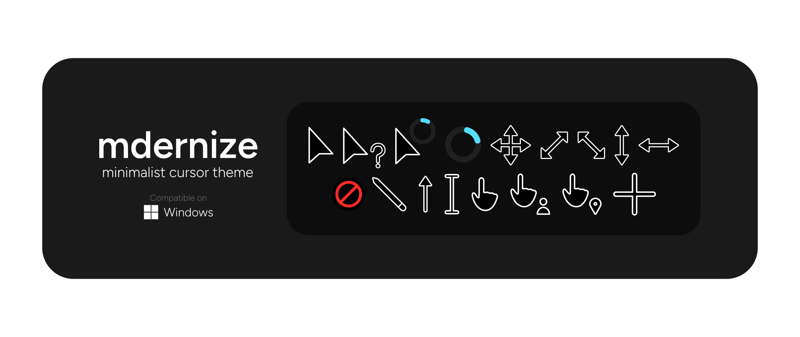
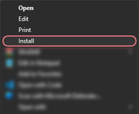
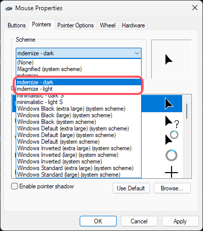

Minimalist cursor theme for Windows. Usability over looks.

## Installation

- Head over to the [Releases](https://www.github.com/user8595/mdernize/releases/latest) section and download the latest version.

- Extract the .zip file.

- Open the folder of each variant (dark & light)

- Then right click the `install.inf` file, and select "Install", as the image below:

- Open the Mouse Properties setting in Control Panel, then select the installed cursor theme, which should look like this:

- You can test the cursor theme using the webpage (`cursor-test.html`) bundled in the `mdernize.zip` file.

## License

Licensed under the [MIT License](./LICENSE.md).